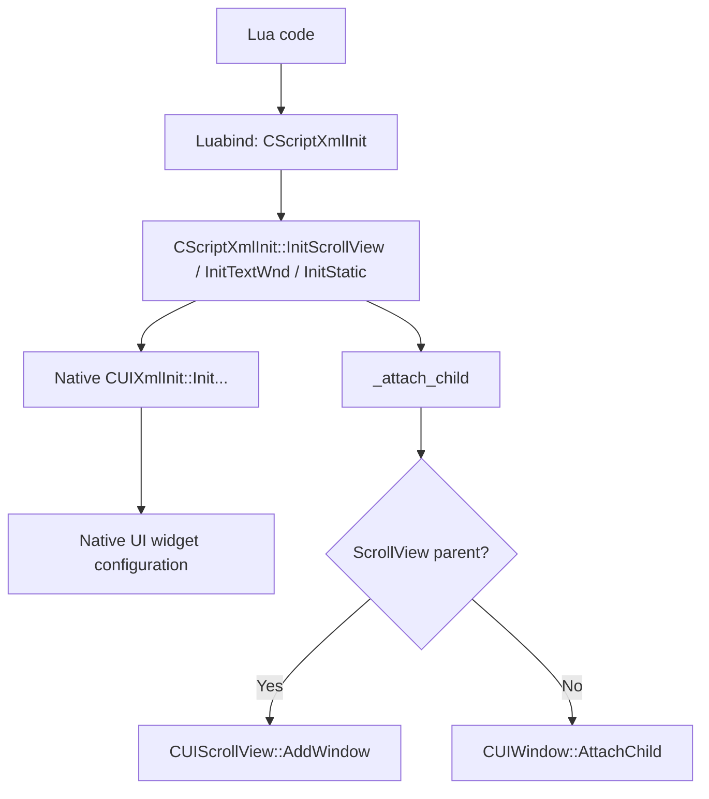

# Native/XML-to-Lua registration and widget construction — Part A

> ADR document set: **v0.1.44**. Research revisions and source/build versions below describe their original scope.

**Source:** pinned `src/xrGame/ScriptXMLInit.cpp`, lines 26–36, 136–205, 337–384. Source-backed conceptual call flow. Actual Lua invocation and binary behavior not yet tested. The origin of bootstrap registration is not shown; no global startup sequence is implied by this diagram.
