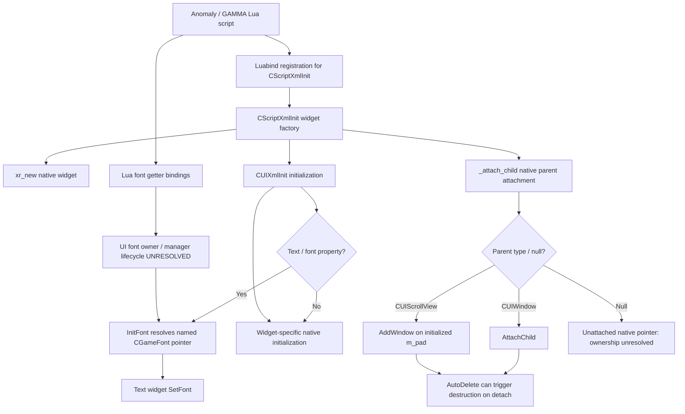

# UI architecture: Lua ↔ native XML ↔ native widgets — Part D

> ADR document set: **v0.1.82**. Research revisions and source/build versions below describe their original scope.

**Target source:** X-Ray Monolith `2026.5.15` (`6a08e0905ce34748ee2904a5e0809f8afd141137`). **Evidence:** Parts A–C historical C++ source inspection. **Runtime:** not tested against installed MT-TEST executable. This is the **integrated architecture map**, not a claim of exhaustive engine documentation.

## Subsystem-level relationship

**Diagram limitations:** The manager-to-font connection is conceptual, and the exact manager creation/destruction sequence remains untraced; arrows do not assert temporal ordering during engine startup. `CScriptXmlInit` registration definition exists; complete bootstrap invocation is not yet traced.

## Cross-layer contract

| Layer | Source-backed observation | Responsibility / caveat |
|---|---|---|
| Native engine (C++) | `CUIXmlInit` configures native widgets; `CGameFont` initializes renderer and metrics | Underlying implementation; not everything is Lua-exposed |
| Binding interface | `CScriptXmlInit::script_register` uses Luabind; `CUIWindow::AttachChild` uses `adopt<2>()` | Native export registration differs from widget ownership |
| Factory bridge | `CScriptXmlInit::InitStatic`, `InitTextWnd`, `InitScrollView`, `InitProgressBar` allocate and initialize | Parentless return ownership not established |
| UI ownership | `SetAutoDelete(true)`, `AttachChild`, `DetachChild`, `DetachAll` | Native deletion may invalidate Lua-side references |
| Fonts | XML `InitFont` resolves a native `CGameFont*`; `CGameFont` loads glyph data and font renderer | Manager lifetime and Lua getter ownership remain open |
| Game/mod layer | Lua and XML consume native objects through these interfaces | GAMMA-specific overrides and runtime behavior not yet verified |

## Implementation-oriented findings (not runtime prescriptions)

1. Prefer a source-supported `CScriptXmlInit` initialization path when creating scroll views: its path calls native `InitScrollView`; direct default construction alone leaves the internal `m_pad` null.
2. Treat cached child-widget pointers as **potentially invalid** after parent detach/destruction when `AutoDelete` is active. This is a source-derived precaution, not an observed Lua crash.
3. Keep three font failure families separate: XML identifier resolution, native `CGameFont` resource/metrics initialization, and Lua-to-C++ `SetFont` pointer types. The CtZ crash mechanism is not established.
4. Never infer direct Lua exposure from the existence of a C++ method. The Lua registration boundary is a separately documented contract.
5. Do not confuse native `AutoDelete` with Luabind's `adopt<2>()` policy; both need to be considered when documenting object lifetime.

## Evidence and navigation

- [Part A: Luabind XML registration](../02-lua-api/registration-architecture-part-A.md), [CScriptXmlInit API](../02-lua-api/ui/classes/CScriptXmlInit.md).
- [Part B: individual CGameFont lifetime](native-font-object-lifecycle.md), [font API notes](../03-ui-pda/font-manager-and-lua-getters.md).
- [Part C: native UI ownership](../03-ui-pda/ui-construction-ownership.md), [investigation](../08-research/investigations/2026-10-09-part-C-ui-construction.md).
- **Pinned registration and factory:** [ScriptXMLInit.cpp](https://github.com/themrdemonized/xray-monolith/blob/6a08e0905ce34748ee2904a5e0809f8afd141137/src/xrGame/ScriptXMLInit.cpp), [UIWindow Lua bindings](https://github.com/themrdemonized/xray-monolith/blob/6a08e0905ce34748ee2904a5e0809f8afd141137/src/xrGame/ui/UIWindow_script.cpp).
- **Pinned native implementations:** [UIXmlInit.cpp](https://github.com/themrdemonized/xray-monolith/blob/6a08e0905ce34748ee2904a5e0809f8afd141137/src/xrGame/ui/UIXmlInit.cpp), [UIWindow.cpp](https://github.com/themrdemonized/xray-monolith/blob/6a08e0905ce34748ee2904a5e0809f8afd141137/src/xrGame/ui/UIWindow.cpp), [UIScrollView.cpp](https://github.com/themrdemonized/xray-monolith/blob/6a08e0905ce34748ee2904a5e0809f8afd141137/src/xrGame/ui/UIScrollView.cpp), [GameFont.cpp](https://github.com/themrdemonized/xray-monolith/blob/6a08e0905ce34748ee2904a5e0809f8afd141137/src/xrEngine/GameFont.cpp).

## Evidence status

- **Source-confirmed (target revision):** named registration definitions, factory delegation, CGameFont object methods, native auto-delete behavior, scroll-view pad initialization.
- **Open:** repository-wide registration coverage; font manager global lifecycle; Luabind return-policy ownership; exact binary correspondence.
- **Deferred:** in-game validation, crash reproduction, GAMMA interaction, actual CtZ font-cause attribution.
