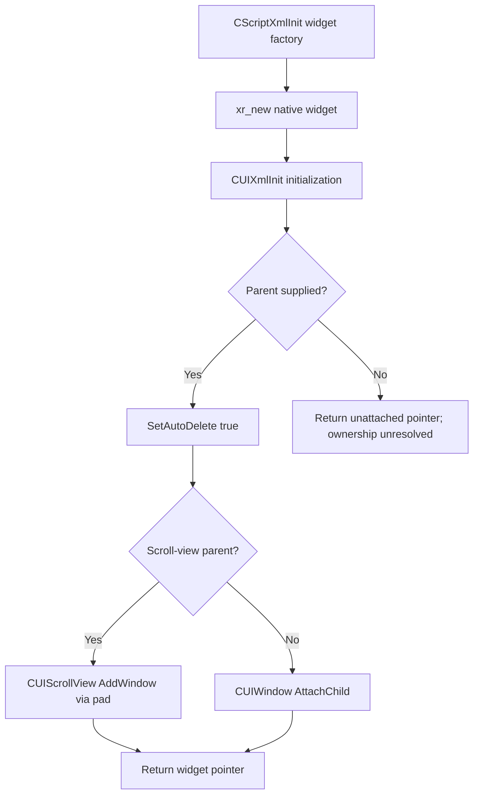

# XML/UI Construction and ownership (Part C)

> ADR document set: **v0.1.47**. Research revisions and source/build versions below describe their original scope.

**Status:** Source-confirmed for pinned May 2026 C++ implementation; runtime untested.

See [Part C investigation](../08-research/investigations/2026-10-09-part-C-ui-construction.md) for precise source locations and limitations.

## Native creation flow

## Critical distinctions

- Allocating `CUIScrollView` does not construct its `m_pad`; XML/native initialization is a separate operation.
- `AutoDelete` controls native deletion on detach; Luabind `adopt<2>()` controls script/C++ ownership transfer at a binding boundary. Do not conflate them.
- `DetachAll` can delete child objects, so cached references should be considered unsafe after native deletion until verified.

Runtime experiments deferred.

## Cross-layer integration

See [Part D native/Lua architecture](../01-engine/ui-lua-native-integration.md) and [prioritized lifecycle questions](../08-research/open-questions-v0.1.10.md).
