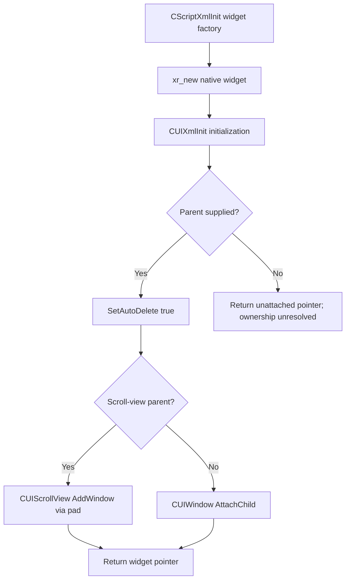

# XML/UI Construction and ownership (Part C)

> ADR document set: **v0.1.77**. Research revisions and source/build versions below describe their original scope.

**Status:** Source-confirmed for pinned May 2026 C++ implementation; independent runtime reproduction untested. Selected external quickload observations are recorded below.

See [Part C investigation](../08-research/investigations/2026-10-09-part-C-ui-construction.md) for precise source locations and limitations.

## Native creation flow

## Critical distinctions

- Allocating `CUIScrollView` does not construct its `m_pad`; XML/native initialization is a separate operation.
- `AutoDelete` controls native deletion on detach; Luabind `adopt<2>()` controls script/C++ ownership transfer at a binding boundary. Do not conflate them.
- `DetachAll` can delete child objects, so cached references should be considered unsafe after native deletion until verified.

Independent ADR runtime experiments remain deferred; the external report below is separate evidence.

## Cross-layer integration

See [Part D native/Lua architecture](../01-engine/ui-lua-native-integration.md) and [prioritized lifecycle questions](../08-research/open-questions-v0.1.10.md).

## Practical teardown rule — externally observed

[Issue #1](https://github.com/Queen-Jadwiga/anomaly-development-reference/issues/1) reports quickload access violations when Lua-created shown/HUD windows remained registered; matching cleanup in `actor_on_net_destroy` reportedly produced three clean quickloads on the stated September-era GAMMA build. Record this as external observed behavior, not independently reproduced universal engine behavior.

Remove native display registrations **before Lua teardown**, using the API matching the registration: `HideDialog` for a window shown as a dialog, `RemoveDialogToRender` for a HUD-render registration. Clearing a Lua reference or relying on `__finalize` is not proof of native alias removal. Keep cleanup idempotent and scoped to registrations the mod actually owns.

This is not a blanket call to HideDialog/delete every XML child or PDA-attached page. Their parent/AutoDelete/holder paths differ and must be traced separately. The precise stale-pointer mechanism and wider build applicability remain open in #1. [Build limits and review](../08-research/investigations/2026-10-12-REV-01-external-runtime-issues.md#ui-lifetime-and-registration-safety).
