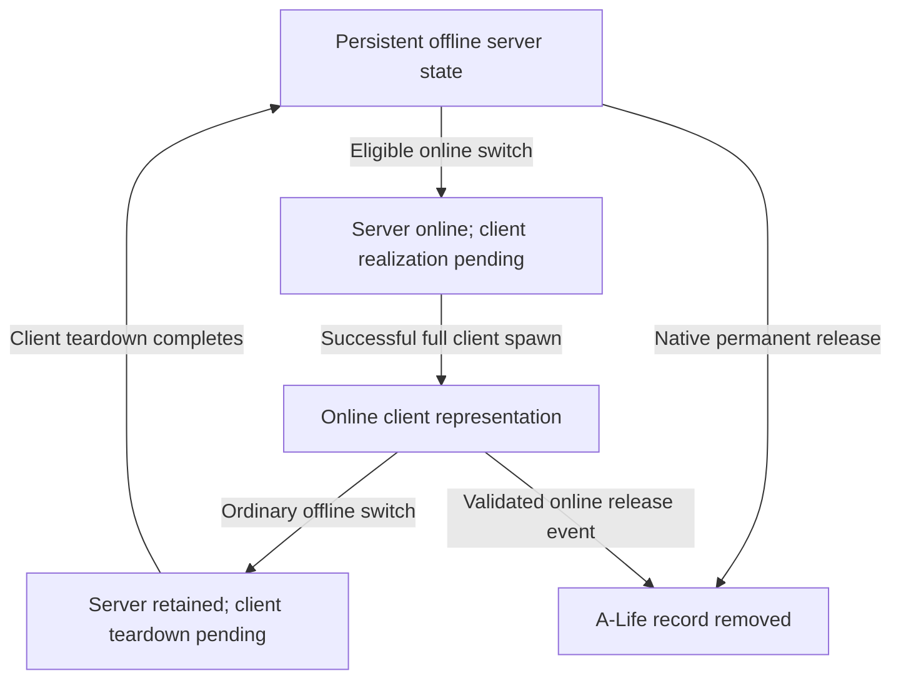

# A-Life lifecycle and state reference

> ADR document set: **v0.1.73**. Research revisions and source/build versions below describe their original scope.

- ID: ALIFE-10 — lifecycle reference
- Subsystem: A-Life / Warfare integration
- Source status: source-confirmed within the linked native and bundled-script scope
- Runtime status: untested; verification deferred until the user resumes it
- Baseline: ENGINE1011, uploaded October 11 source snapshot; installed GAMMA correspondence unknown
- Last reviewed: 2026-10-11

Use this page to identify the representation and state you need before using an API. The companion [callback reference](callback-phase-reference.md) explains observation timing. Evidence labels L01–L47 refer exclusively to the [lifecycle/callback ledger](../../evidence/alife/lifecycle-callbacks-2026-10-11.csv), which names files, symbols, one-based ranges and full-file hashes. The engine archive SHA-256 is `14d82b26f0e2579898e912c87224ee87a4c9daafc0c5950d5a322406d15e6aee`; its upstream commit and executable equivalence remain unknown.

## Representations and authorities

| Representation | What it supplies | What its presence does not prove |
| --- | --- | --- |
| Persistent A-Life server object | Stored transform, graph/node IDs, serialized native state and server identity; resolve with `alife():object(id)` | A client object, fully initialized Lua board state, or a lifetime-unique ID |
| Native online/offline group | Member map and group-owned offline movement; supplied `sim_squad_scripted` derives from this container | A client-rendered squad container, complete member pointer repair during load, or smart arrival |
| Online server network entry | Recipient of update packets and source of spawn packets for the inspected online paths | Finished client spawn or a fresh position sample |
| Client game object | Online transform, client AI/binder state and object callbacks; client lookup is separate from A-Life lookup | Durable existence across switching, full derived initialization immediately after lookup starts succeeding, or permanent server removal when destroyed |
| Lua board, assignments and bookmarks | Script-maintained strategic membership, targets and cached locations | Equivalence to native group membership, generic serialization of arbitrary fields, or the installed Warfare policy |

Sources: native registration L02; network realization L05/L21; group update/membership L12/L16; client registration/spawn L22/L24; packet import L29–L31; bundled board insertion L07 and bookmark policy L26/L27. Selected Lua fields and ownership contracts are in the [server/squad API](../../02-lua-api/alife/server-squad-api.md); lookup contracts are in the [simulator API](../../02-lua-api/alife/simulator-api.md).

## Online representation cycle

This diagram tracks an individual/member's representations, not mutually exclusive global execution states. Client events may be queued/postponed, spawn may fail or be skipped, and server offline processing can resume while client teardown is pending. The release arrow represents server A-Life removal; associated client teardown can still be pending. An online group realizes its **members**, rather than spawning a client group container in the inspected method. Attachments and group-managed registry updates have their own branches. L05/L16/L21/L24/L39/L41/L42/L45/L46; details in [ALIFE-06](../../08-research/investigations/2026-10-11-ALIFE-06-graph-online-realization.md) and [ALIFE-07](../../08-research/investigations/2026-10-11-ALIFE-07-client-server-offline-teardown.md).

## Creation, registration and reconstruction

| Route | Source ordering | Practical consequence |
| --- | --- | --- |
| Direct section creation | Allocate/initialize server object → optional native registration → supplies → `on_spawn` | With immediate callbacks enabled, `on_register` is earlier than completion of the creation call. L01/L02 |
| Spawn-template creation | Clone state/assign ID → register → control/location/member or supplies work → `on_spawn` | Do not generalize direct-section readiness to every creation route. L01 |
| Online-parent creation / manual `register` | Temporary description serialized and consumed → `Process_spawn` returns replacement | Validate and use the returned object; retaining the consumed input pointer is inappropriate. `reg=false` is conditional on the wrapper's online-parent branch. L04/L05 |
| Fresh `Process_spawn` | Network insertion → single-player `OnCreate` adoption/registration → later parent linkage/post-create | Immediate registration can precede final parent linkage; adoption temporarily clears the parent ID. L01/L05/L06 |
| Existing-object online realization | Existing A-Life object → online network insertion/packet → client spawn processing | Skips fresh `OnCreate`/`OnPostCreate`; it is not a new persistent creation. L05/L21 |
| New-game bulk initialization | Registration callbacks suppressed during object creation, then separate callback loop | Immediate-spawn callback order does not describe every bulk-initialization object. See [ALIFE-02](../../08-research/investigations/2026-10-11-ALIFE-02-creation-registration-release.md) |
| Save reconstruction | Construct new objects/read saved IDs → native registry reconstruction with final registration callbacks suppressed → registry-container load → callback loop → late group pointer repair | Saved IDs can be present while member pointer values are still null. Reacquire objects; old pointers do not survive reconstruction. L10–L13 |

Native registration calls `on_before_register`, optionally inserts the object, updates graph/schedule/story/smart/group registries, sets up the simulator and handles attached items, then conditionally calls `on_register`. Each registry helper has its own admission rules. This is not a promise that every object belongs to every registry or that Lua strategic initialization has completed. L02, `register_object:23–56`.

## Offline scheduling, tasks and movement

| Boundary | Checked contract | Development implication |
| --- | --- | --- |
| Manager update | Switching precedes the separate scheduled-update stage | Registry membership can change before movement updates. L15 |
| Offline group membership | Members normally leave independent graph/schedule processing; group brain moves the group, then copies location to non-null members | Do not model the ordinary offline group update as one independent brain update per member. L12/L16 |
| Lua/native task handoff | Group brain asks virtual `get_current_task`, then advances GamePath; bundled Lua update calls native base before later target selection | A target set later in that Lua invocation generally feeds a later movement invocation; no fixed frame delay is established. L17/L18 |
| Graph edge crossing | Graph registration and stored representative position/node change → native location hook → subsequent group member-copy loop | Native edge observation can precede member propagation. L16/L19/L20 |
| Lua graph/level notification | Later Lua code compares cached old location with the final location after native update | Several native edges can become one sampled old-to-final notification. L47 |
| Arrival | Movement-manager completion, detail-path completion and Lua smart reach tests have different meanings | Use the actual task/reach contract; a generic `completed()` result does not establish Warfare capture or physical arrival. See [ALIFE-05](../../08-research/investigations/2026-10-11-ALIFE-05-offline-scheduling-brains.md) and [movement API](../../02-lua-api/alife/server-squad-api.md#task-and-movement-controls) |

Eligibility, schedule membership and actual activity are separate. Online groups are explicitly removed from scheduled offline processing; always-true group `need_update` does not mean they run their brain every online frame. `force_update()` calls scheduled updates rather than the full switching pass. L15/L16 and [simulator controls](../../02-lua-api/alife/simulator-api.md#state-controls-and-iteration).

## Switching controls and positions

Switch-permission setters and Lua `forced_online_status` are inputs to a later decision, not immediate realization commands. Current-level, attachment, synchronization and group/member checks still matter. With both effective individual permissions true, online admission is at `d <= D(1-F)` and offline admission at `d > D(1+F)`. Other permission combinations and native/Lua exceptions are detailed in [ALIFE-08](../../08-research/investigations/2026-10-11-ALIFE-08-switching-eligibility.md); active distance/factor/configuration values remain unknown. L35/L36.

| Position/state | Where it comes from | Boundary |
| --- | --- | --- |
| Stored server `o_Position` | Offline location changes or imported client update | Not always the newest rendered client position. L19/L29–L31 |
| Offline display position | Detail-path `draw_level_position` interpolation when applicable | Spawn packet writes stored `o_Position`; no inspected replacement with interpolated display position. L05/L20/L21 |
| Client spawn transform | Spawn packet, AI location validation, possible plane correction, later binder/derived work | Early spawn callback is not a final-position guarantee. L22/L26/L37/L38 |
| Online update position | Selected monster exporters use sampled `NET.back()`; packet reader imports it | Some extra graph hints can be based on more current AI data; import does not directly replace current graph/node IDs. See [ALIFE-07](../../08-research/investigations/2026-10-11-ALIFE-07-client-server-offline-teardown.md). L29–L31 |
| Map marker position | Matching client `Position()` when present; otherwise server `draw_level_position()` for ordinary non-actor-relative markers | Map authority can change as client lookup becomes available. L33 |
| Offline group origin | Synchronize first member, then copy its server location | Not an average of client transforms or a new client sample. L45 |

## Offline teardown, death and permanent release

| Event | What changes | What to avoid inferring |
| --- | --- | --- |
| Ordinary offline switch | Network representation removed; existing ID reserved; persistent A-Life object retained under control | Death, A-Life unregister, or final client-state flush. L32/L42/L45/L46 |
| Client `GE_DESTROY` and teardown | Destroy flag queues object-list teardown; release notifications precede reverse-order `net_Destroy`/`Destroy` processing | Immediate completed deletion at event receipt, or durable client pointers afterward. L23/L28/L40 |
| Creature death | Separate health/death and casualty-handling paths | Complete member cleanup or permanent release. Effective overrides and safe-release chain remain open; see [WAR-002b](../../08-research/investigations/2026-10-11-WAR-002b-policy-offline-combat.md) |
| Native permanent release | Recursively release attached children → unregister → clear A-Life control → destruction as applicable | Recursion over the native squad member map: this path follows attached `children`. L01/L02 |
| Lua release | Offline: direct native release. Online: destroy-event route with validation before native removal | A synchronous deletion acknowledgement, or meaning for the wrapper's ignored boolean argument. L04/L41 |

Ordinary offline removal has no explicit `ClientSend`/`ClientSave` final-snapshot barrier in the inspected route. Native opaque `client_data` and Lua offline bookmarks are separate. Ordinary dynamic/group paths clear eligible client data at different points; virtual `keep_saved_data_anyway` has subclass exceptions. The supplied monster binder can write a bookmark during teardown, and the supplied startup wrapper clears it afterward for recognized squad members. Installed execution/replacement order remains unknown. L10/L26/L27/L32/L43–L46.

## Persistence and identity rules for CtZ

Native save preparation explicitly sends updates and client-save data; the object registry then saves included object state. Load reconstructs instances with saved numeric IDs and repairs native member pointers later. Arbitrary Lua fields are not automatically persisted by these operations. L10–L13/L29/L31; [ALIFE-04](../../08-research/investigations/2026-10-11-ALIFE-04-save-load-identity.md).

**Design implications, not mod changes:** reacquire and validate representations at each phase; distinguish creation from load replay; tolerate repeated observations of one event; count casualties from the intended death/accounting authority rather than representation loss. Numeric IDs can be freed and reused, so campaign records need identity validation beyond successful lookup if they can outlive release. Source establishes the reuse risk, not a reproduced CtZ defect. L14 and ALIFE-04's CtZ reconciliation analysis.

Completion: this native/bundled-source lifecycle synthesis is complete within scope. Effective board/smart assignment, reach/jobs, creature death/safe release, strategic persistence and global startup/dispatch routes remain open. Continue from the [current roadmap](../../ROADMAP.md); runtime stays deferred.
