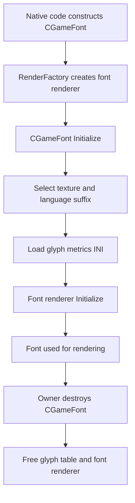

# Part B — Font manager investigation (2026-10-09)

> ADR document set: **v0.1.56**. Research revisions and source/build versions below describe their original scope.

**Disposition:** PARTIAL. No runtime tests. Historical commit: `6a08e0905ce34748ee2904a5e0809f8afd141137`.

## Files inspected

- [`src/xrEngine/GameFont.cpp`](https://github.com/themrdemonized/xray-monolith/blob/6a08e0905ce34748ee2904a5e0809f8afd141137/src/xrEngine/GameFont.cpp) — confirmed constructors, resource selection, glyph metrics, font renderer allocation and destruction.
- [`src/xrEngine/x_ray.cpp`](https://github.com/themrdemonized/xray-monolith/blob/2026.5.15/src/xrEngine/x_ray.cpp) — searched for `_InitializeFont` and `pFontSystem`; neither was found in the inspected file. A missing symbol in one file is **not** evidence of engine-wide absence.
- Prior pinned [`src/xrGame/ui/UIXmlInit.cpp`](https://github.com/themrdemonized/xray-monolith/blob/2026.5.15/src/xrGame/ui/UIXmlInit.cpp) — earlier XML `InitFont` resolution findings are unchanged.

## Confirmed call sequence



Note: diagram intentionally does not claim which higher-level owner constructs or destroys the font.

## Open questions retained for full-tree or targeted source audits

- **FONT-B-01:** Identify exact UI font manager class and member pointers to named font objects.
- **FONT-B-02:** Determine font-manager allocation, startup order, and config-loading path.
- **FONT-B-03:** Determine destruction order and renderer/device reset/reload behavior.
- **FONT-B-04:** Trace Lua font getter implementations and registration site to manager pointer ownership.
- **FONT-B-05:** Check special cases during resolution changes or renderer resets.
- **FONT-B-06:** Runtime validate against the installed MT-TEST 2026.05.15 executable later.

Recommended checkout queries:

```bash
git checkout 2026.5.15
git grep -n -E 'class CFontManager|FontManager|CGameFont\*|GetFontSmall|GetFontMedium' -- src
git grep -n -E 'xr_new<CGameFont>|xr_delete.*Font|DestroyFontRender|CreateFontRender' -- src
```

**Prior Part A unresolved:** registration startup sequence and potential alternative `CUIXmlInit` Lua export remain open, unchanged.
