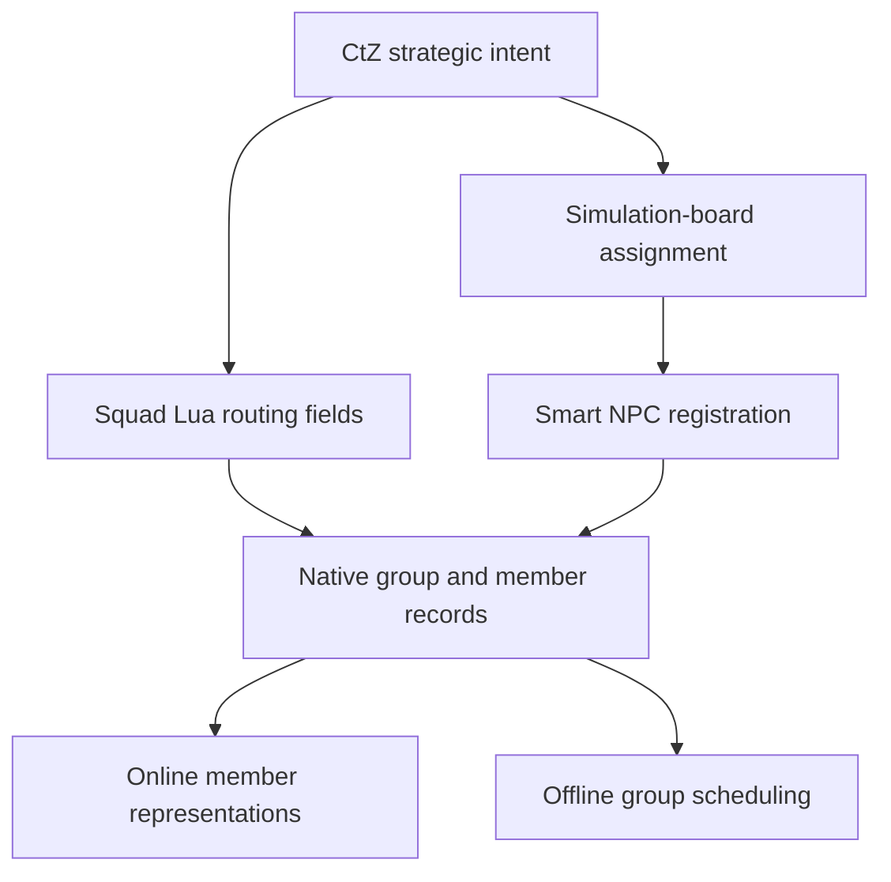

# WAR-001 — CtZ integration boundary and source prerequisites

> ADR document set: **v0.1.67**. Research revisions and source/build versions below describe their original scope.

**ADR v0.1.31 · source inspection only; in-game verification deferred.**

## Sources kept separate

- **Native engine and bundled squad script:** user-supplied October 11 archive; see [ALIFE-01](2026-10-11-ALIFE-01-identity-lifecycle.md) and its [evidence ledger](../../evidence/alife/source-evidence-oct11.csv).
- **CtZ:** Alpha 0.0.5j Revised Fixed Bars / Advantage Marker, published at commit [`eba6660db09353dcc42a195ae6e7e706f4762277`](https://github.com/Queen-Jadwiga/capture-the-zone/commit/eba6660db09353dcc42a195ae6e7e706f4762277). This is CtZ implementation evidence, not independent verification of GAMMA behavior.
- **Effective Anomaly/GAMMA/Warfare scripts:** not supplied for this source pass. Engine-bundled replacements are not assumed to be the MO2 winning files.

## Observed CtZ call sites

| CtZ operation | Pinned code | Verified source behavior and boundary |
| --- | --- | --- |
| Mark campaign ownership | [ctz_campaign.script:350–355](https://github.com/Queen-Jadwiga/capture-the-zone/blob/eba6660db09353dcc42a195ae6e7e706f4762277/gamedata/scripts/ctz_campaign.script#L350-L355) | Sets `ctz_campaign_owned`, faction, detachment and role fields on the squad. Assignment does not itself prove serialization of these fields. |
| Anchor a garrison | [357–392](https://github.com/Queen-Jadwiga/capture-the-zone/blob/eba6660db09353dcc42a195ae6e7e706f4762277/gamedata/scripts/ctz_campaign.script#L357-L392) | Attempts `assign_smart(smart, old_smart_id)` and `SIMBOARD:assign_squad_to_smart`; clears scripted-target fields and writes routing state. The calls use `pcall`; successful arrival or registration is not implied merely by reaching this code. |
| Set a movement target | [590–610](https://github.com/Queen-Jadwiga/capture-the-zone/blob/eba6660db09353dcc42a195ae6e7e706f4762277/gamedata/scripts/ctz_campaign.script#L590-L610) | Attempts to clear board assignment, then changes scripted and assigned target fields. A destination field is intent, not proof that a squad occupies or controls the destination. |

**Terminology:** `sim_squad_scripted` and `SIMBOARD` are Lua gameplay layers. Calling their routing “native” in existing CtZ comments should not be read as saying their policy is implemented wholly in C++. No gameplay code is changed by this research increment.

The bundled squad `assign_smart` confirms that old/new NPC registration operations exist, but the external board implementation and installed GAMMA patches are still missing. Existing CtZ comments about map-transition reconstruction explain the author's intent; they are not newly source-verified statements about the effective profile.

## Relationship map

Edges from CtZ to routing/board calls are inspected CtZ code; member registration/switching is inspected native or bundled source. The board-to-smart edge is a dependency to trace, not a completed call graph. Faction capture and CtZ UI refresh are intentionally not added as proven edges.

## Source prerequisites and open questions

A later source-only pass needs the **effective files from the active MO2 profile**, with hashes and supplying-mod names. Priority files: `sim_squad_scripted.script`, `sim_board.script`, `smart_terrain.script`, `simulation_objects.script`, `warfare_options.script`, and the actual Warfare capture/combat modules they call. A merged/virtual-file view or the winning files plus their overrides is more useful than an unqualified base-game copy.

Questions to close:

1. Which layer selects and changes a smart terrain's faction owner, and what constitutes capture?
2. Which patch replaces squad update/online-status behavior, in what order?
3. How does clearing board assignment update `smart_id`, NPC jobs and old smart rosters?
4. Does offline combat remove members through the same death path as online combat?
5. Which events can CtZ observe without duplicating counts or confusing unregister/load with death?
6. Which CtZ strategic IDs and added squad fields survive each save/load path?

No runtime verification is required to inspect these scripts. Runtime tests stay queued for later; until source is available, further native A-Life investigation can continue independently.
